# Combat effects in motion

Filmed by `SampleProject/UI/film_fx.gd` (DesertRoad, a stationary dummy or enemy, HUD hidden, the hero takes no real damage), packed by `Scripts/Tools/fx_pack.py`: each GIF cropped around the hero and the target, game pixels x2 nearest, 15 fps; each sheet is 6 frames evenly through the clip. Report: [[fx-film]].

| Effect | From (file / skill id) | GIF | Sheet | Meant to show |
|---|---|---|---|---|
| `level_up` | `Scenes/FX/LevelUpFlash.tscn`, `LevelUpParticles.tscn` | 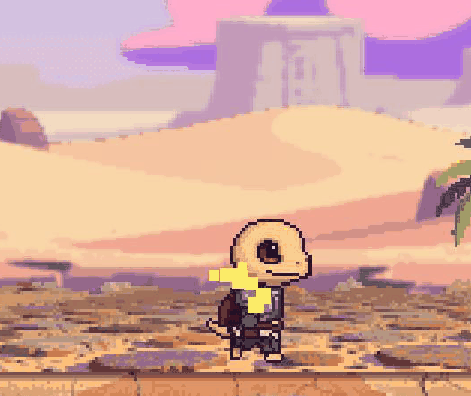 | [sheet](level_up_sheet.jpg) | Level-up flash and golden particles (Player._spawn_level_up_vfx) |
| `landing_dust` | `Scenes/FX/LandingDust.tscn` | 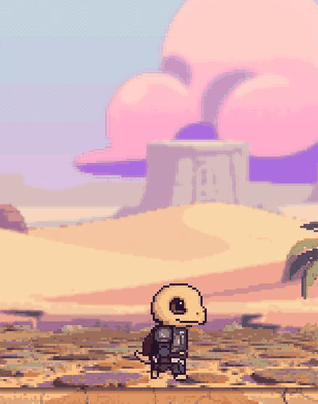 | [sheet](landing_dust_sheet.jpg) | Landing dust after a jump (VFXHooks._on_player_landed, LandingDust.tscn) |
| `punch_combo` | `Assets/FX/Smear/punch_1-3`, `Hit/cut_1-4`, `SlashTrail.tscn`, `HitImpact.tscn` | 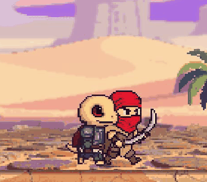 | [sheet](punch_combo_sheet.jpg) | Bare-hand combo: punch streaks (Smear/punch_1-3) and the hit cut (Hit/cut_1-4) |
| `sword_combo` | `Assets/FX/Smear/arc_1-3`, `Hit/cut_1-4` | 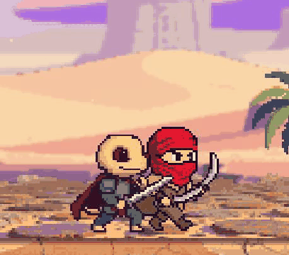 | [sheet](sword_combo_sheet.jpg) | Sword combo: swing crescents (Smear/arc_1-3), the finisher bigger |
| `mace_combo` | `Assets/FX/Smear/arc_1-3`, `Hit/cut_1-4` | 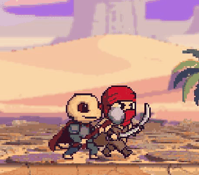 | [sheet](mace_combo_sheet.jpg) | Mace combo: swing crescents (Smear/arc_1-3) |
| `dagger_combo` | `Assets/FX/Smear/thrust_1-3`, `Hit/cut_1-4` | 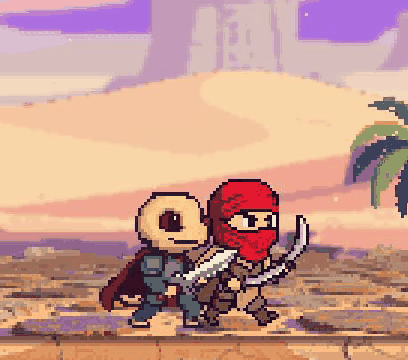 | [sheet](dagger_combo_sheet.jpg) | Dagger combo: thrust streaks (Smear/thrust_1-3) |
| `halberd_combo` | `Assets/FX/Smear/thrust_1-3`, `arc_1-3` | 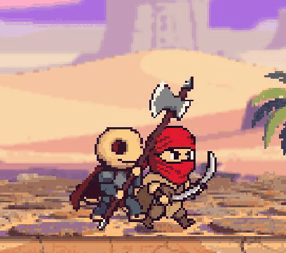 | [sheet](halberd_combo_sheet.jpg) | Halberd combo: thrusts and a sweep (Smear/thrust, arc) |
| `dual_combo` | `Assets/FX/Smear/arc_1-3`, `thrust_1-3` | 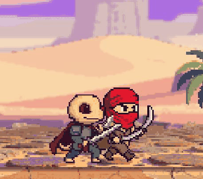 | [sheet](dual_combo_sheet.jpg) | Sword + dagger dual-wield: four fast swings |
| `heavy_attack` | `Assets/FX/Smear/arc_1-3` (x1.4), `Hit/cut_1-4` | 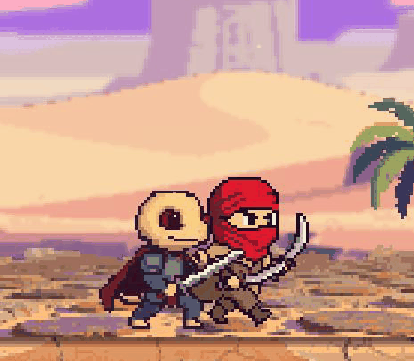 | [sheet](heavy_attack_sheet.jpg) | Sword heavy attack: the big crescent, heavy hit feel |
| `bow_quick_shot` | `Assets/FX/Projectiles/arrow.png` | 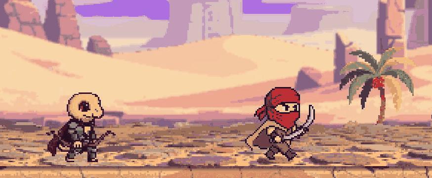 | [sheet](bow_quick_shot_sheet.jpg) | Bow quick shots: the arrow (Projectiles/arrow.png) and its hit |
| `bow_charged_shot` | `Assets/FX/Projectiles/arrow_charged.png` | 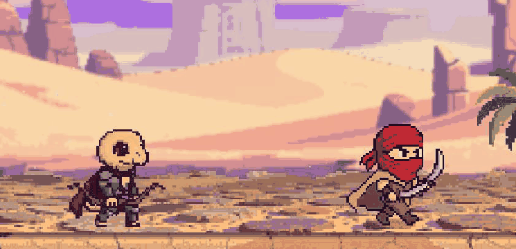 | [sheet](bow_charged_shot_sheet.jpg) | Bow held: draw, charged glow, the piercing charged arrow (arrow_charged.png) |
| `skill_fire_strike` | `fire_strike` - `Skills/fire_arc.png`, `Scenes/FX/Skills/FireStrike.tscn` | 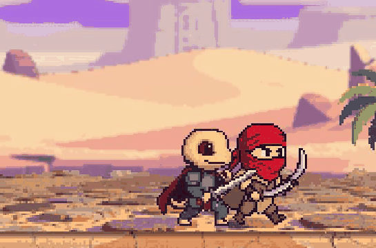 | [sheet](skill_fire_strike_sheet.jpg) | Fire Strike: wind-up, then the fire crescent (Skills/fire_arc.png) |
| `skill_electric_strike` | `electric_strike` - `Skills/bolt.png`, `ElectricStrike.tscn` |  | [sheet](skill_electric_strike_sheet.jpg) | Electric Strike: the bolt in the wind-up and from the sky at the release (Skills/bolt.png) |
| `skill_healing_palm` | `healing_palm` - `Skills/heal_aura.png`, `HealingPalm.tscn` | 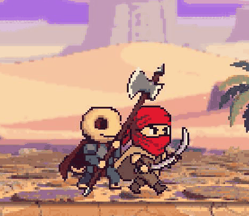 | [sheet](skill_healing_palm_sheet.jpg) | Healing Palm: the healing ring (Skills/heal_aura.png) |
| `skill_radiant_smite` | `radiant_smite` - `Assets/FX/Skills/radiant_smite/charge_*, release_*`, `OathSkill.tscn` | 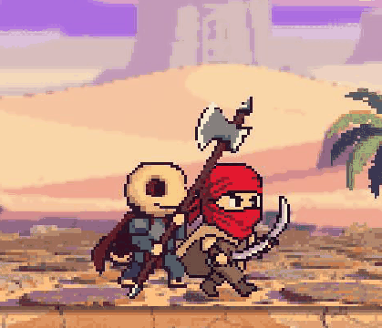 | [sheet](skill_radiant_smite_sheet.jpg) | radiant_smite (oath paladin): own charge and release frames (Skills/radiant_smite/) |
| `skill_skyfall_blessing` | `skyfall_blessing` - `Assets/FX/Skills/skyfall_blessing/charge_*, release_*`, `OathSkill.tscn` | 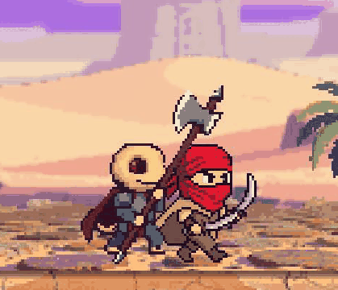 | [sheet](skill_skyfall_blessing_sheet.jpg) | skyfall_blessing (oath paladin): own charge and release frames (Skills/skyfall_blessing/) |
| `skill_judgement_of_the_sky` | `judgement_of_the_sky` - `Assets/FX/Skills/judgement_of_the_sky/charge_*, release_*`, `OathSkill.tscn` | 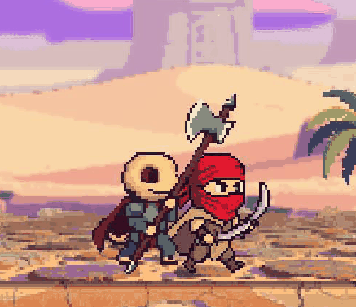 | [sheet](skill_judgement_of_the_sky_sheet.jpg) | judgement_of_the_sky (oath paladin): own charge and release frames (Skills/judgement_of_the_sky/) |
| `skill_searing_hex` | `searing_hex` - `Assets/FX/Skills/searing_hex/charge_*, release_*`, `OathSkill.tscn` | 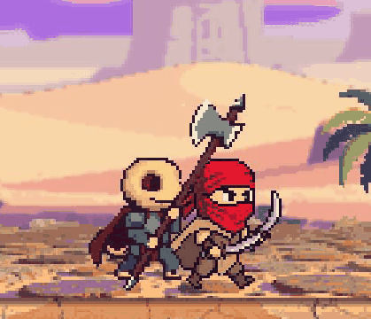 | [sheet](skill_searing_hex_sheet.jpg) | searing_hex (oath dark_knight): own charge and release frames (Skills/searing_hex/) |
| `skill_withering_grasp` | `withering_grasp` - `Assets/FX/Skills/withering_grasp/charge_*, release_*`, `OathSkill.tscn` | 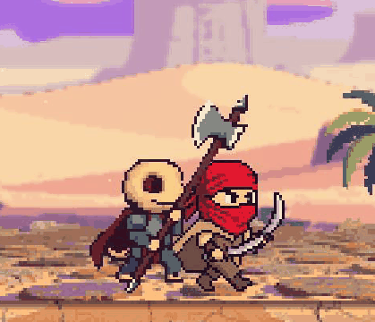 | [sheet](skill_withering_grasp_sheet.jpg) | withering_grasp (oath dark_knight): own charge and release frames (Skills/withering_grasp/) |
| `skill_eclipse_cleave` | `eclipse_cleave` - `Assets/FX/Skills/eclipse_cleave/charge_*, release_*`, `OathSkill.tscn` | 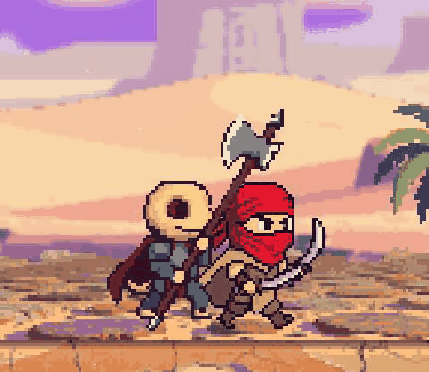 | [sheet](skill_eclipse_cleave_sheet.jpg) | eclipse_cleave (oath dark_knight): own charge and release frames (Skills/eclipse_cleave/) |
| `skill_balanced_strike` | `balanced_strike` - `Assets/FX/Skills/balanced_strike/charge_*, release_*`, `OathSkill.tscn` |  | [sheet](skill_balanced_strike_sheet.jpg) | balanced_strike (oath warden): own charge and release frames (Skills/balanced_strike/) |
| `skill_dervish_whirl` | `dervish_whirl` - `Assets/FX/Skills/dervish_whirl/charge_*, release_*`, `OathSkill.tscn` | 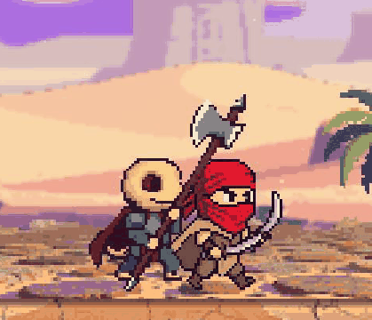 | [sheet](skill_dervish_whirl_sheet.jpg) | dervish_whirl (oath warden): own charge and release frames (Skills/dervish_whirl/) |
| `skill_second_wind` | `second_wind` - `Assets/FX/Skills/second_wind/charge_*, release_*`, `OathSkill.tscn` | 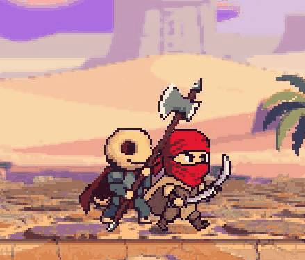 | [sheet](skill_second_wind_sheet.jpg) | second_wind (oath warden): own charge and release frames (Skills/second_wind/) |
| `parry_spark` | `Scenes/FX/ParrySpark.tscn` (VFXHooks._on_guard) | 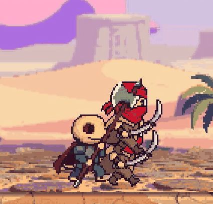 | [sheet](parry_spark_sheet.jpg) | Parry: the hero blocks just as the bandit strikes - parry sparks (ParrySpark.tscn) |
| `block_spark` | `Scenes/FX/ParrySpark.tscn` x0.5 | 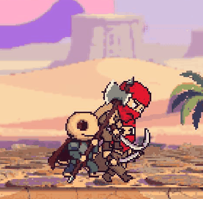 | [sheet](block_spark_sheet.jpg) | Block: the hero holds block through the strike - smaller block sparks |
| `enemy_shield_sparks` | `ParrySpark.tscn` (VFXHooks._on_shield) | 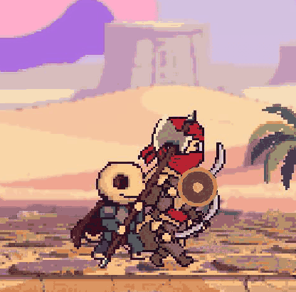 | [sheet](enemy_shield_sparks_sheet.jpg) | Hits on a shield bandit's shield: shield sparks, a heavy hit breaks it |
| `enemy_melee` | `Scripts/FX/EnemyStrikeFX.gd` (melee); hurt: `HitImpact.tscn`, `HurtVignette.tscn` | 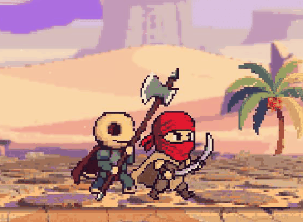 | [sheet](enemy_melee_sheet.jpg) | Enemy strike (melee): its smear from EnemyStrikeFX.WEAPONS, then the hit on the hero (red cut, vignette) |
| `enemy_bandit_brute` | `Scripts/FX/EnemyStrikeFX.gd` (bandit_brute); hurt: `HitImpact.tscn`, `HurtVignette.tscn` | 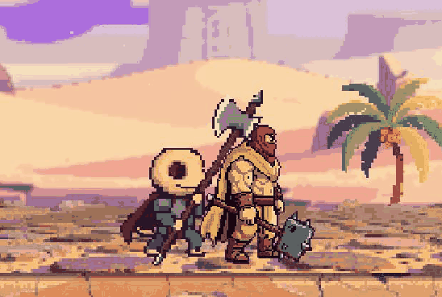 | [sheet](enemy_bandit_brute_sheet.jpg) | Enemy strike (bandit_brute): its smear from EnemyStrikeFX.WEAPONS, then the hit on the hero (red cut, vignette) |
| `enemy_armoured_scorpion` | `Scripts/FX/EnemyStrikeFX.gd` (armoured_scorpion); hurt: `HitImpact.tscn`, `HurtVignette.tscn` | 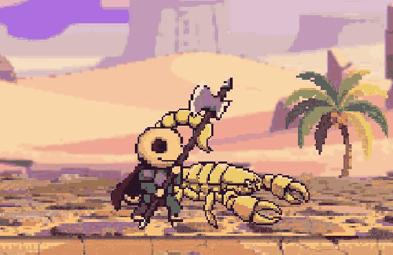 | [sheet](enemy_armoured_scorpion_sheet.jpg) | Enemy strike (armoured_scorpion): its smear from EnemyStrikeFX.WEAPONS, then the hit on the hero (red cut, vignette) |
| `enemy_fast` | `Scripts/FX/EnemyStrikeFX.gd` (fast); hurt: `HitImpact.tscn`, `HurtVignette.tscn` | 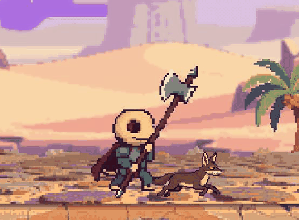 | [sheet](enemy_fast_sheet.jpg) | Enemy strike (fast): its smear from EnemyStrikeFX.WEAPONS, then the hit on the hero (red cut, vignette) |
| `enemy_jackal_cursed` | `Scripts/FX/EnemyStrikeFX.gd` (jackal_cursed), `CursedFoam.tscn`; hurt: `HitImpact.tscn`, `HurtVignette.tscn` | 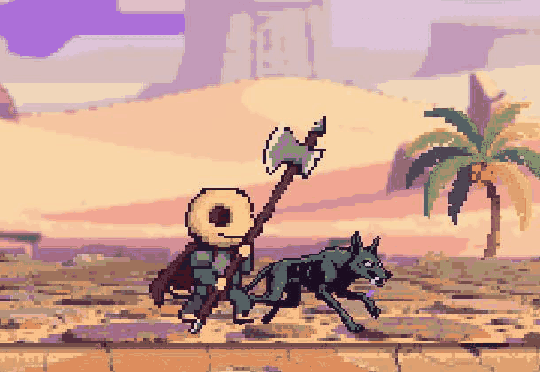 | [sheet](enemy_jackal_cursed_sheet.jpg) | Enemy strike (jackal_cursed): its smear from EnemyStrikeFX.WEAPONS, then the hit on the hero (red cut, vignette) |
| `enemy_vulture` | `Scripts/FX/EnemyStrikeFX.gd` (vulture); hurt: `HitImpact.tscn`, `HurtVignette.tscn` | 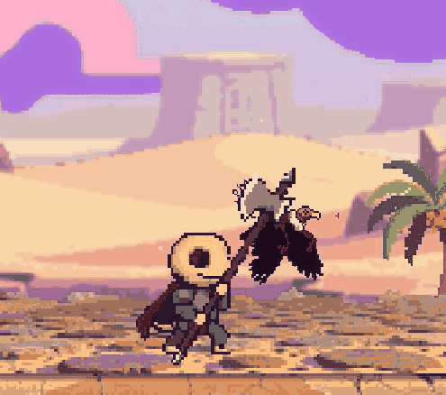 | [sheet](enemy_vulture_sheet.jpg) | Enemy strike (vulture): its smear from EnemyStrikeFX.WEAPONS, then the hit on the hero (red cut, vignette) |
| `enemy_archer` | `Scripts/FX/EnemyStrikeFX.gd` (archer); hurt: `HitImpact.tscn`, `HurtVignette.tscn` | 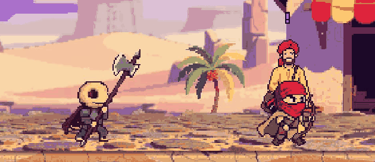 | [sheet](enemy_archer_sheet.jpg) | Enemy strike (archer): its smear from EnemyStrikeFX.WEAPONS, then the hit on the hero (red cut, vignette) |
| `boss_fire_djinn_fireball` | `Assets/FX/Bosses/fireball.png`, `Scenes/FX/Bosses/boss_fireball.tscn` | 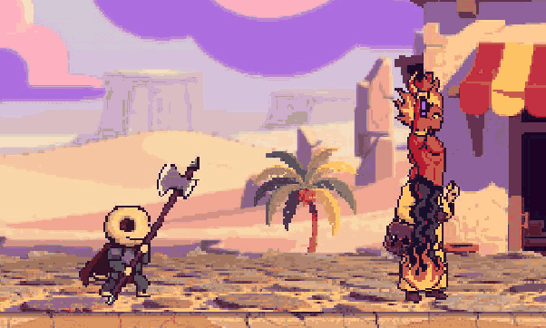 | [sheet](boss_fire_djinn_fireball_sheet.jpg) | Fire djinn: the fireball (Bosses/fireball.png, boss_fireball.tscn) |
| `boss_fire_djinn_pillar` | `Assets/FX/Bosses/mark.png`, `pillar.png`, `boss_pillar.tscn` | 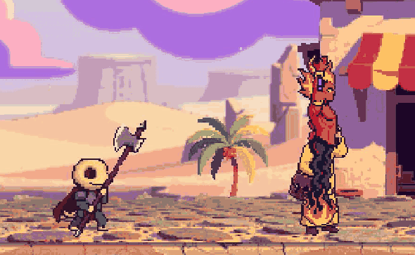 | [sheet](boss_fire_djinn_pillar_sheet.jpg) | Fire djinn: the floor mark, then the fire pillar (Bosses/mark.png, pillar.png) |
| `boss_brass_collector_slam` | `Assets/FX/Bosses/shockwave.png`, `boss_shockwave.tscn`; EnemyStrikeFX slam | 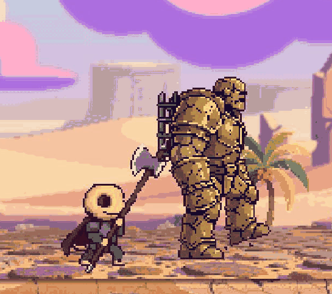 | [sheet](boss_brass_collector_slam_sheet.jpg) | Brass Collector: the slam, its shockwave and dust (Bosses/shockwave.png) |
| `companion_alisia` | `Scenes/FX/Companions/charge_glow`, `arrow_streak`, `hit_spark` | 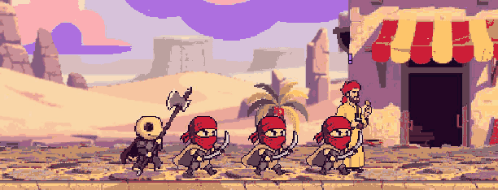 | [sheet](companion_alisia_sheet.jpg) | Alisia: green draw glow, the arrow streak, hit sparks (Companions/charge_glow, arrow_streak, hit_spark) |
| `companion_astrit` | `Scenes/FX/Companions/landing_dust`, `charge_glow`, `shield_slam`, `stun_stars` | 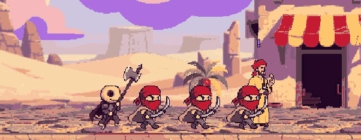 | [sheet](companion_astrit_sheet.jpg) | Astrit: drops in - landing dust, charge glow, shield slam, stun stars |
| `companion_urizen` | `Scenes/FX/Companions/charge_glow`, `gold_burst` |  | [sheet](companion_urizen_sheet.jpg) | Urizen: gold glow, the coin chaining to three enemies - gold bursts |
| `companion_guard` | `Scenes/FX/Companions/wind_arc`, `knockback_puff` | 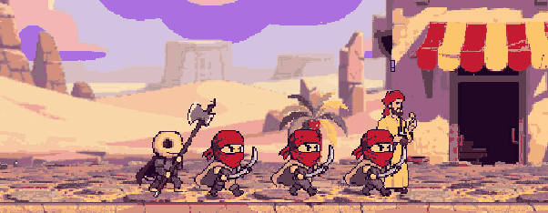 | [sheet](companion_guard_sheet.jpg) | City Gates guard: runs in, the thrust ends with a wind arc, knockback puff |
| `enemy_death` | `Scenes/FX/DeathParticles.tscn`, `DamageNumber.tscn` | 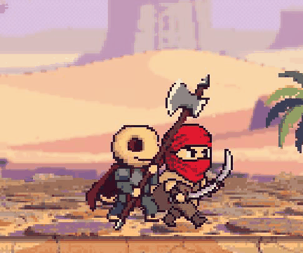 | [sheet](enemy_death_sheet.jpg) | Enemy death: the last hit, damage number, death particles (DeathParticles.tscn) |
